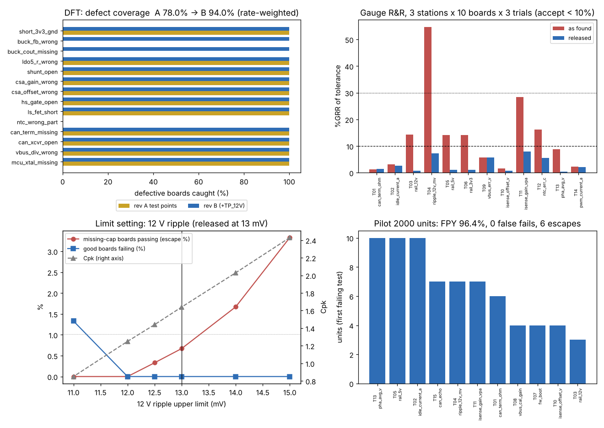

# PCBA end-of-line tester: DFT, limits, gauge R&R and pilot buy-off

[](https://github.com/vansh0906/pcba-eol-tester/actions/workflows/ci.yml)

An automated end-of-line (EOL) tester for a **robot-joint driver board** (48 V bus, buck + two LDOs, 3-phase
MOSFET bridge, shunt current sense, NTC, CAN), taken through the steps a test engineer owns before a tester is
released to the line: **DFT review of test-point coverage**, **limit setting from capability (Cpk)**, **gauge R&R
across three stations**, a **2,000-unit pilot build**, **failure diagnosis** and **log analytics in Rust**.

The board, its assembly defects and the station instruments are **modeled** (part tolerances, instrument
calibration errors and noise, firmware ADC behaviour). The tester code, the test plan, the statistics and the
decisions are the real thing, and every number below comes from running this repository.



## Results

| Study | Before | After | What changed |
|---|---|---|---|
| DFT coverage (rate-weighted) | rev A **78.0%** (escapes 1,100 DPMU) | rev B **94.0%** (300 DPMU) | asked EE for a TP_12V + GND pad pair: catches a wrong buck feedback resistor and a missing output cap |
| Good boards failing the plan | draft plan **22.8%** | released plan **0.0%** | 3.3 V limit from the tolerance stack; firmware VREFINT; EOL bus-voltage calibration; current-sense method |
| Bus-voltage reading Cpk | **0.31** (fw 1.4.2) | **16.4** (fw 1.5.0 + EOL cal) | ADC referenced to the real supply, then a per-unit gain written to flash by the tester |
| Gauge R&R (%GRR of tolerance) | 6 tests not accepted, ripple **54.6%** | all 12 accepted, worst **7.9%** | scope probe setup, station 2 DMM recalibrated, 10 A / 64-sample current test, 8 temperature reads |
| Pilot, 2,000 units, rev B | | FPY **96.4%**, **0** false fails, min Cpk **1.45**, **732** units/h on 3 stations | 6 escapes, all one defect the EOL test cannot see at room temperature (documented, sent to SMT) |
| Failure diagnosis | v1 **93.1%** | v2 **100%** (72/72) | v1 confused an open shunt with a wrong gain resistor |

Details: [FINDINGS](docs/FINDINGS.md) · [TEST_PLAN](docs/TEST_PLAN.md) · [results/report.md](results/report.md)

## Run it

```
python3 -m pip install -r requirements.txt
python3 -m pytest -q          # 10 tests, about 5 s (includes the Rust cross-check if cargo is installed)
python3 run_all.py            # every study, about 10 s; writes results/ and docs/img/results.png
cd tools/tlog && cargo run --release -- ../../results/pilot_log.csv
```

## Layout

```
config/board.yaml      the board: parts with tolerances, revisions A/B test points, defect library with rates
config/limits.yaml     the test plan: 15 tests, draft and released limits, stop-on-fail, test times
config/stations.yaml   three stations: DMM/current-source calibration as found and released, probe and method setups
eol/board.py           the modeled board: rails, ripple, current sense, NTC, bridge, CAN; defects change the circuit
eol/instruments.py     station instruments (DMM, scope, ohmmeter, PSU, current source, temperature) and the firmware
eol/sequence.py        the tester: runs the plan on one unit, logs one row per test, stops on safety failures
eol/stats.py           Cpk and crossed gauge R&R by ANOVA
eol/studies.py         DFT coverage, limit study, ripple trade-off, gauge study, pilot, failure diagnosis
run_all.py             runs everything, writes results/ (JSON, the pilot's tester log CSV, report.md) and the figure
tools/tlog/            Rust CLI: yield, per-station yield, first-fail Pareto, Cpk from a tester log (std only)
tests/test_eol.py      CI checks, incl. Rust vs Python on the same log
```

Modeled: the board, defects, instruments and firmware. Real: the test plan, tester logic, limit setting, MSA
statistics, the decisions and the tools.
